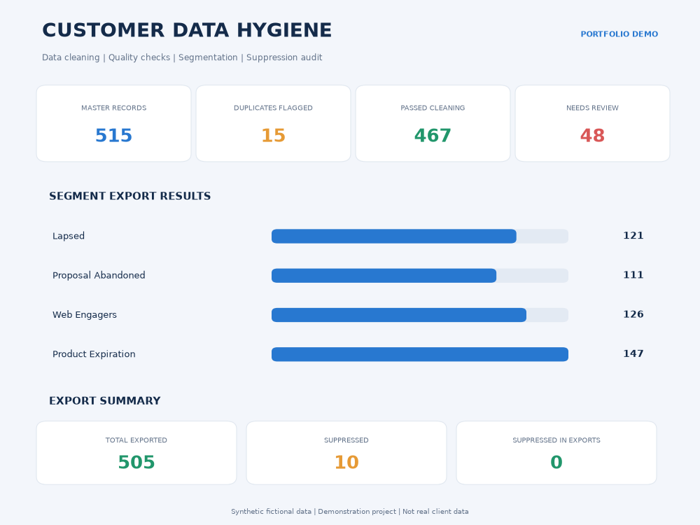
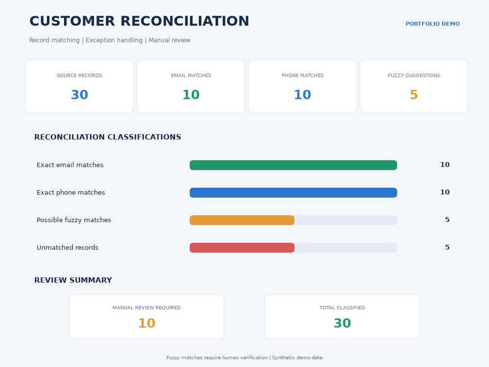

# Customer Data Hygiene & Reconciliation

A Python-based data quality and customer reconciliation project demonstrating data cleaning, standardization, segmentation, suppression-list protection, and record matching.

> **Portfolio Demonstration:** All datasets are fictional and synthetically generated. This project does not contain real client or customer data.

## Project Overview

This project demonstrates an end-to-end customer data hygiene workflow designed to improve data quality, identify duplicate records, organize customer segments, protect suppression lists, and reconcile customer records across datasets.

## Features

- Customer data cleaning and standardization
- Email validation and phone normalization
- Duplicate customer identification
- Four customer segment exports
- Suppression-list matching and exclusion
- Exact email and phone reconciliation
- Fuzzy name matching using RapidFuzz
- Unmatched record identification
- Manual review reports
- Automated data validation checks
- Excel and CSV report generation

## Technology Stack

| Technology | Purpose |
|---|---|
| Python 3 | Core programming |
| Pandas | Data cleaning and manipulation |
| OpenPyXL | Excel file processing |
| RapidFuzz | Fuzzy record matching |
| Regular Expressions | Data validation and normalization |
| Matplotlib | Portfolio dashboard visualization |

## Portfolio Dashboard Screenshots

### 1. Customer Data Hygiene Dashboard



Shows customer record quality, duplicate identification, cleaning results, segmentation, and suppression summary.

### 2. Customer Reconciliation Dashboard



Shows exact email matches, phone matches, fuzzy matching suggestions, unmatched records, and manual review requirements.

## Demo Results

### Data Cleaning

| Metric | Result |
|---|---:|
| Input records | 515 |
| Duplicate records flagged | 15 |
| Quality passed | 467 |
| Records requiring review | 48 |

### Segmentation and Suppression

| Metric | Result |
|---|---:|
| Total records | 515 |
| Suppressed records | 10 |
| Exported records | 505 |
| Unmatched segment records | 0 |

### Customer Reconciliation

| Match Category | Records |
|---|---:|
| Exact email matches | 10 |
| Exact phone matches | 10 |
| Possible fuzzy matches | 5 |
| Unmatched records | 5 |
| Manual review required | 10 |

### Validation Results

- Data validation: PASS
- Suppression validation: PASS
- Reconciliation validation: PASS

## Project Structure

```text
customer-data-hygiene-reconciliation/
│
├── src/
│   ├── generate_data.py
│   ├── clean_data.py
│   ├── create_suppression.py
│   ├── export_segments.py
│   ├── validate_project.py
│   ├── create_reconciliation_data.py
│   ├── reconcile_customers.py
│   └── validate_reconciliation.py
│
├── portfolio/
│   ├── create_dashboard.py
│   ├── customer_data_hygiene_dashboard.png
│   └── customer_reconciliation_dashboard.png
│
├── input/
├── output/
├── reports/
├── requirements.txt
└── README.md
```

Input, output, and report datasets are generated locally and excluded from Git tracking.

## Installation

### 1. Clone the Repository

```bash
git clone https://github.com/Anand-aii/customer-data-hygiene-reconciliation.git

cd customer-data-hygiene-reconciliation
```

### 2. Create a Virtual Environment

```bash
python3 -m venv .venv

source .venv/bin/activate
```

### 3. Install Dependencies

```bash
pip install -r requirements.txt
```

## Run the Project

Execute the following scripts in order:

```bash
python src/generate_data.py

python src/clean_data.py

python src/create_suppression.py

python src/export_segments.py

python src/validate_project.py

python src/create_reconciliation_data.py

python src/reconcile_customers.py

python src/validate_reconciliation.py
```

Generated Excel files, CSV exports, and reports are saved locally.

## Important Notes

- All datasets are synthetic and fictional.
- Fuzzy matches are suggestions, not confirmed identities.
- Possible matches require human verification.
- Suppression matching currently uses normalized email addresses.
- This is a portfolio demonstration, not a production-ready integration system.
- Actual business workflows may require additional validation and integration.

## Skills Demonstrated

- Python Data Cleaning
- Data Quality Assurance
- Data Standardization
- Customer Segmentation
- Duplicate Detection
- Data Reconciliation
- Fuzzy Matching
- Excel Automation
- CSV Processing
- Reporting and Visualization

## About the Developer

**Anand | GitHub: Anand-aii**

Web Developer and Python project developer interested in building practical automation, data processing, and web solutions.

**GitHub Profile:** https://github.com/Anand-aii

**Project Repository:** https://github.com/Anand-aii/customer-data-hygiene-reconciliation
